# Enterprise DevSecOps CI/CD Platform

[](https://www.jenkins.io/)
[](https://www.docker.com/)
[](https://aws.amazon.com/eks/)
[](https://aws.amazon.com/)
[](https://www.terraform.io/)
[](https://www.sonarqube.com/)
[](https://trivy.dev/)
[](https://prometheus.io/)
[](https://grafana.com/)

An end-to-end DevSecOps implementation that automates the build, security scanning, containerization, deployment, and monitoring of a Netflix-style clone application.

This repository contains the architecture, infrastructure workflow, Jenkins pipeline guidance, operational runbook, and screenshots used to deliver the platform.

---

## Project Highlights

- Jenkins declarative pipelines for CI/CD orchestration
- SonarQube static code analysis and quality-gate integration
- Trivy filesystem and container image vulnerability scanning
- Docker image build and registry publishing
- AWS EKS deployment with Terraform and Kubernetes manifests
- Prometheus and Grafana observability
- Jenkins email notifications and build artifact retention
- Infrastructure lifecycle through `apply` and `destroy` pipeline parameters

---

## Architecture

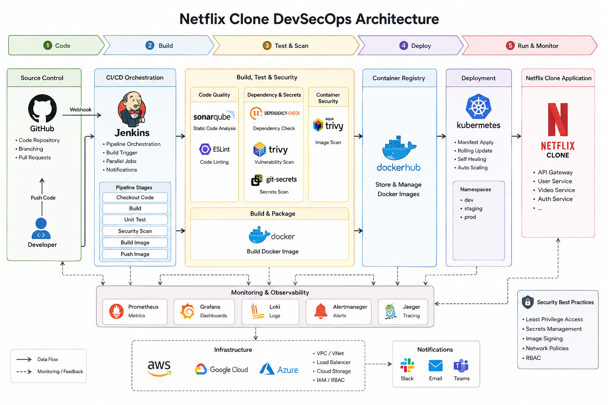

The complete architecture workflow is also available as a GIF:

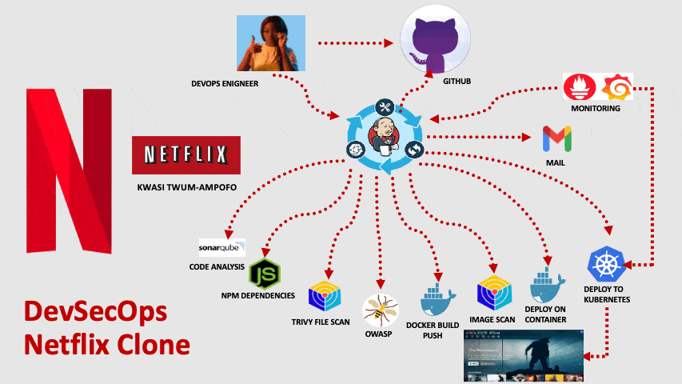

### Delivery Flow

```text
Developer
   |
   | Push / Pull Request
   v
GitHub
   |
   | Webhook
   v
Jenkins Pipeline
   |
   +-- Clean workspace and checkout
   +-- SonarQube analysis
   +-- Quality gate
   +-- Install dependencies
   +-- Trivy filesystem scan
   +-- Docker build and push
   +-- Trivy image scan
   +-- Docker deployment
   +-- Kubernetes / AWS EKS deployment
   |
   +-- Email notifications
   +-- Prometheus metrics
   +-- Grafana dashboards
```

---

## Technology Stack

| Area | Technologies |
|---|---|
| Source control | GitHub |
| CI/CD | Jenkins, Jenkins Declarative Pipeline |
| Code quality | SonarQube Scanner, SonarQube Quality Gate |
| Security scanning | Trivy, OWASP Dependency Check / NPM dependency checks |
| Runtime | Docker, Node.js |
| Container registry | Docker Hub |
| Cloud infrastructure | AWS EC2, AWS EKS, AWS S3 |
| Infrastructure as Code | Terraform |
| Container orchestration | Kubernetes, kubectl |
| Monitoring | Prometheus, Node Exporter |
| Visualization | Grafana |
| Notifications | Email Extension Plugin |

---

## Repository Layout

```text
.
|-- Architecture-latest.png       # Current platform architecture
|-- Architecure.png               # Alternative architecture diagram
|-- architecture.gif              # Architecture animation
|-- Netflix-new-working with EKS.txt
|                              # Detailed infrastructure and Jenkins runbook
|-- secret.txt                    # Environment-specific kubeconfig; keep private
|-- Sereenshoots/
|   |-- ci-cd-pipeline.png
|   |-- ec2-instances.png
|   |-- s3-bucket.png
|   |-- cluster-loadbalancer.png
|   |-- TMDK-API.png
|   |-- sonarqube.png
|   |-- prometheus-targets.png
|   |-- grafana-dashboard.png
|   +-- website.png
```

> **Security notice:** `secret.txt` is environment-specific and must never contain real credentials or be committed to a public repository. Rotate any exposed access credentials and use Jenkins Credentials or a Kubernetes Secret for runtime authentication.

---

## Jenkins Pipeline Stages

The main application pipeline follows this sequence:

1. Clean the Jenkins workspace.
2. Check out the application source code.
3. Run SonarQube analysis.
4. Wait for the configured SonarQube quality gate.
5. Install Node.js dependencies with `npm`.
6. Scan the workspace filesystem with Trivy.
7. Build and push the Docker image.
8. Scan the published image with Trivy.
9. Deploy to Docker.
10. Apply Kubernetes deployment and service manifests to EKS.
11. Send build status and scan attachments by email.

The infrastructure pipeline uses Terraform to initialize, validate, plan, and either apply or destroy the EKS environment through a Jenkins `action` parameter.

---

## Prerequisites

Provision a workstation or server with the following:

- Ubuntu 24.04 or a compatible Linux host
- Java 21 or later
- Jenkins
- Docker and Docker Compose
- Terraform
- AWS CLI
- kubectl
- Git
- SonarQube
- Trivy
- Prometheus and Grafana
- An AWS account with permissions to create EC2, EKS, IAM, S3, networking, and load-balancer resources

Recommended Jenkins plugins:

- Eclipse Temurin Installer
- SonarQube Scanner
- NodeJS
- Docker Pipeline / Docker Commons
- Kubernetes / Kubernetes CLI
- Terraform
- Prometheus
- Email Extension
- OWASP Dependency-Check

---

## Setup Overview

Detailed commands and Jenkins configuration steps are documented in [Netflix-new-working with EKS.txt](./Netflix-new-working%20with%20EKS.txt).

### 1. Provision the Jenkins host

- Launch an Ubuntu EC2 instance.
- Allocate sufficient CPU, memory, storage, and public-access rules for the expected workload.
- Install Java, Jenkins, Docker, Trivy, Terraform, AWS CLI, and kubectl.
- Use an IAM role or scoped credentials rather than embedding AWS keys on disk.

### 2. Configure SonarQube

Run SonarQube in Docker, create a project token, and register the server in Jenkins:

```text
Manage Jenkins
  -> Credentials
  -> Add a secret text credential for the SonarQube token
  -> System
  -> Add SonarQube server
  -> Configure the SonarQube webhook
```

Keep SonarQube and Jenkins private behind a firewall or VPN whenever possible.

### 3. Configure the application credentials

Create Jenkins credentials for:

- Docker registry authentication
- The AWS role or AWS credential provider
- Kubernetes access
- SonarQube access
- Email notification authentication
- The TMDB API key used by the application build

Pass sensitive values through Jenkins credential bindings or environment variables. Do not place API keys or passwords directly in a Jenkinsfile or source repository.

### 4. Provision AWS infrastructure

Create a private S3 bucket for Terraform remote state, configure Jenkins with the Terraform executable, and run the infrastructure pipeline with the `apply` action.

Verify the cluster after provisioning:

```bash
aws eks update-kubeconfig --region ap-south-1 --name EKS_CLUSTER
kubectl get nodes
kubectl get all --all-namespaces
```

Use `destroy` only after verifying that the environment may be removed.

### 5. Run the application pipeline

Configure the Jenkins application pipeline with the branches, tool names, credential IDs, registry, and Kubernetes manifests that match your environment.

After the pipeline succeeds, verify:

- Docker image publication
- Trivy scan reports
- SonarQube quality gate status
- Kubernetes pods and services
- Application endpoint or AWS load balancer
- Prometheus targets
- Grafana dashboards

---

## Monitoring

Prometheus scrapes Jenkins, Node Exporter, and application metrics. Grafana provides dashboards for infrastructure health and Jenkins performance.

Useful targets to verify:

- Prometheus: `http://<prometheus-host>:9090`
- Prometheus targets: `http://<prometheus-host>:9090/targets`
- Grafana: `http://<grafana-host>:3000`
- Node Exporter: `http://<node-host>:9100`

Change default monitoring credentials before exposing the services.

---

## Jenkins, Security, and Kubernetes Screenshots

<table>
  <tr>
    <td width="50%">
      <strong>CI/CD Pipeline</strong><br>
      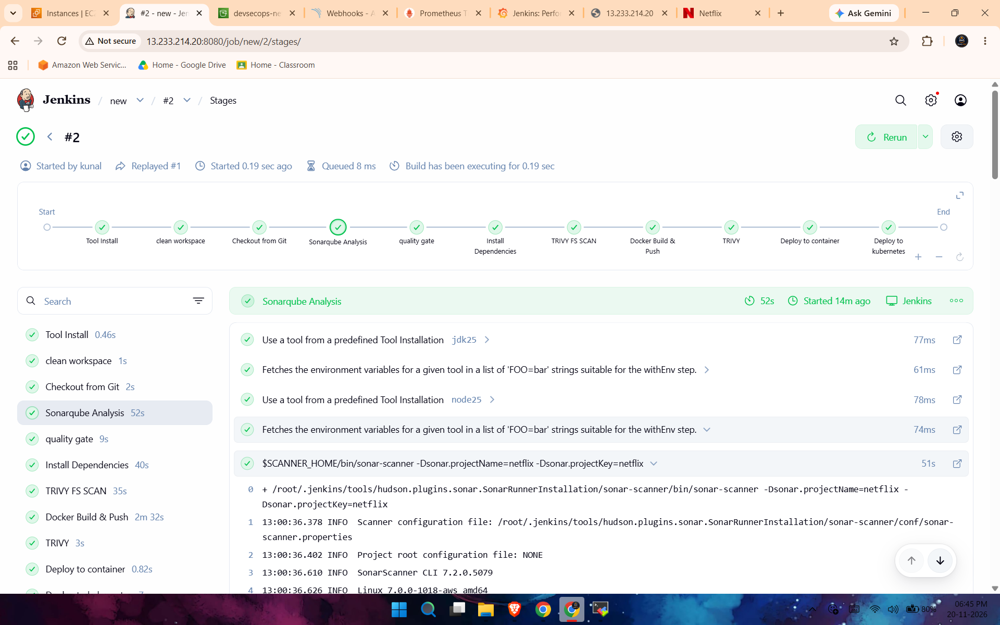
    </td>
    <td width="50%">
      <strong>SonarQube Webhooks</strong><br>
      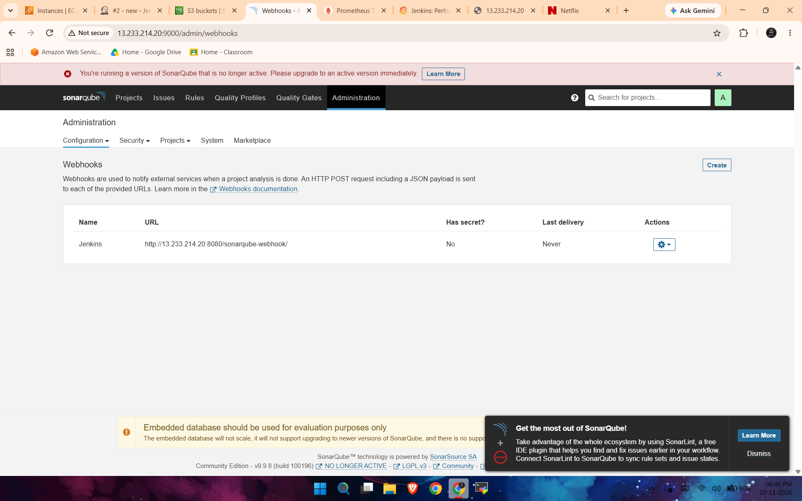
    </td>
  </tr>
  <tr>
    <td width="50%">
      <strong>Prometheus Targets</strong><br>
      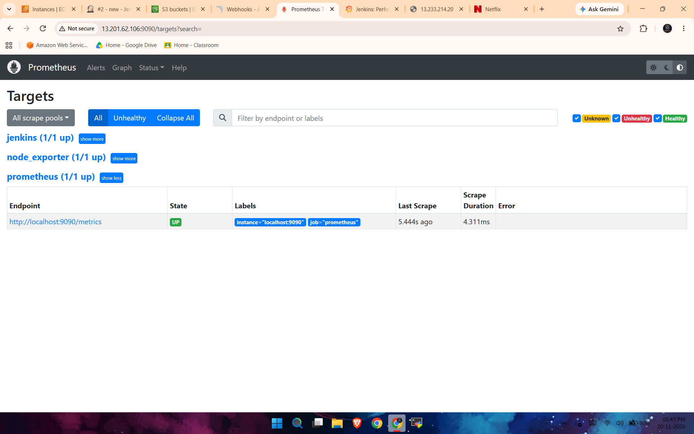
    </td>
    <td width="50%">
      <strong>Grafana Dashboard</strong><br>
      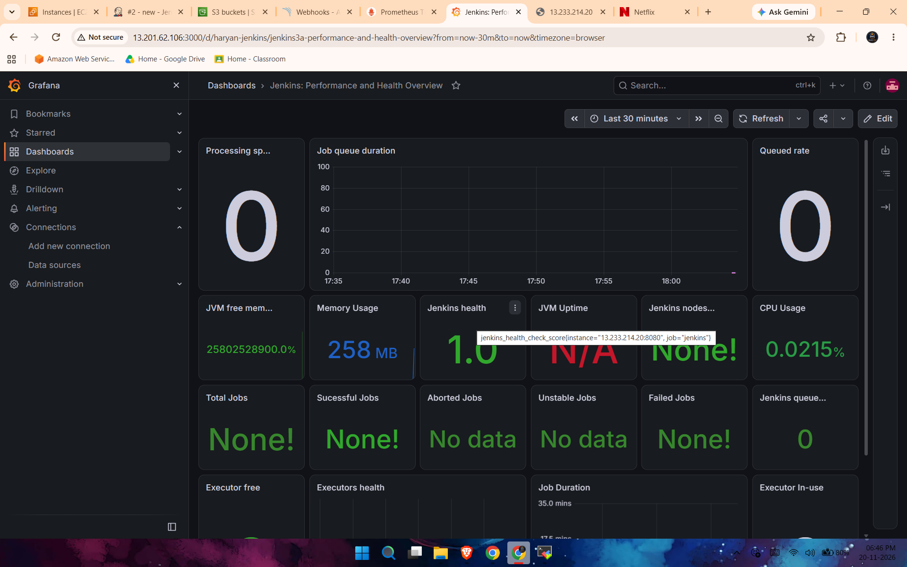
    </td>
  </tr>
  <tr>
    <td width="50%">
      <strong>Netflix Application</strong><br>
      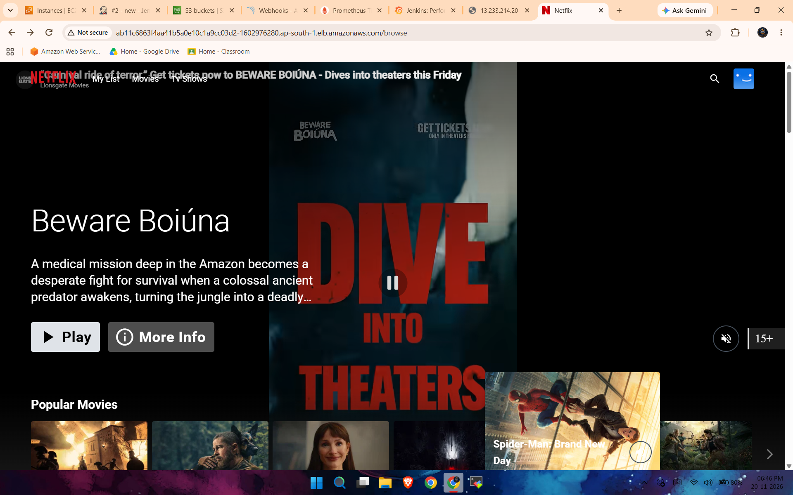
    </td>
    <td width="50%">
      <strong>EKS Load Balancer</strong><br>
      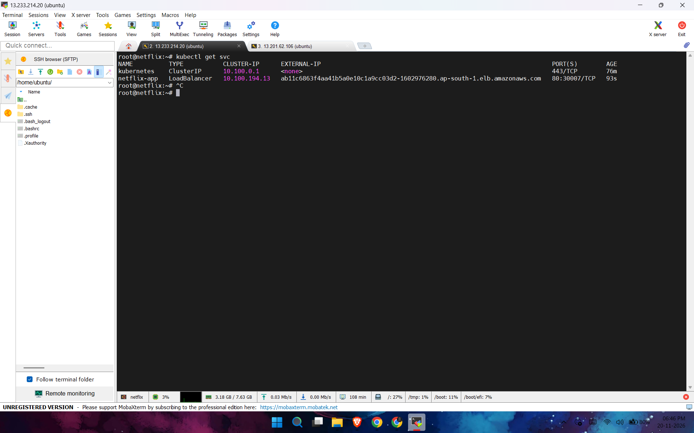
    </td>
  </tr>
  <tr>
    <td width="50%">
      <strong>EC2 Infrastructure</strong><br>
      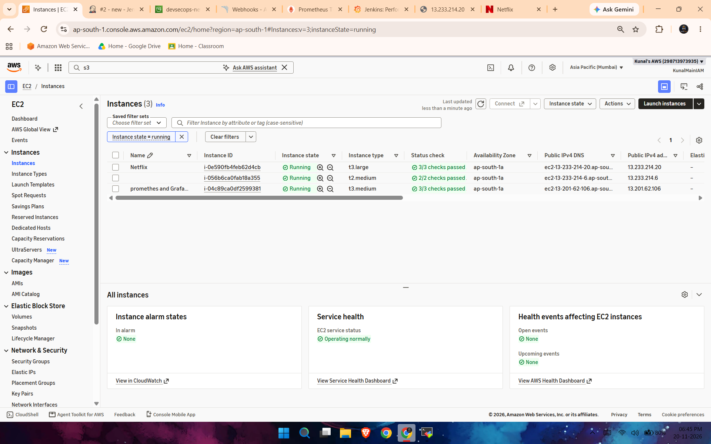
    </td>
    <td width="50%">
      <strong>Terraform State Storage</strong><br>
      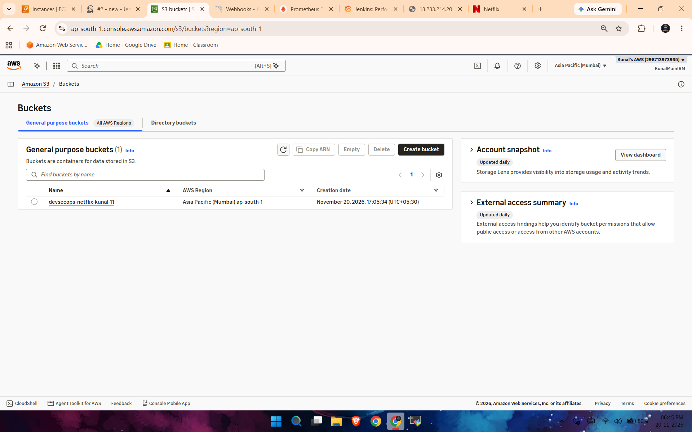
    </td>
  </tr>
</table>

Additional TMDB API setup evidence:

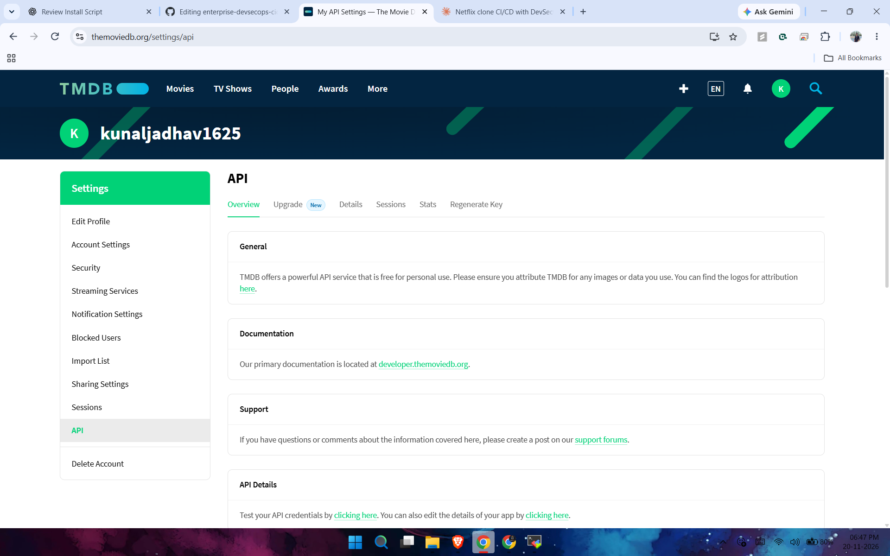

---

## Security Best Practices

- Never commit API keys, tokens, passwords, AWS credentials, or kubeconfig files.
- Use Jenkins Credentials or AWS Secrets Manager for sensitive values.
- Use least-privilege IAM roles instead of attaching broad administrator permissions.
- Store Terraform state in a private, encrypted, versioned S3 bucket.
- Enable state locking and protect the state bucket from unintended deletion.
- Restrict Jenkins, SonarQube, Grafana, Prometheus, and application ports with security groups.
- Add Docker image signing and an enforceable admission policy for production clusters.
- Configure Kubernetes RBAC and network policies.
- Review Trivy findings before allowing production deployment.
- Terminate temporary EC2 and EKS resources when they are no longer required.

---

## Troubleshooting

### Jenkins cannot connect to Docker

```bash
sudo chmod 777 /var/run/docker.sock
sudo systemctl daemon-reload
sudo systemctl restart docker
```

Prefer granting Jenkins access through a managed Docker group policy rather than permanent world-writable socket permissions.

### Docker API compatibility error

Configure the Docker service override, restart Docker, and validate the Jenkins Docker plugin again.

### Jenkins cannot access the EKS cluster

```bash
aws eks update-kubeconfig --region ap-south-1 --name EKS_CLUSTER
kubectl get nodes
```

Confirm that the Jenkins identity has permission to use the EKS cluster and that its kubeconfig is stored as a Jenkins credential.

### Prometheus does not show a target

Validate the Prometheus configuration and reload the service:

```bash
promtool check config /etc/prometheus/prometheus.yml
sudo systemctl restart prometheus
```

Then verify the endpoint under **Prometheus -> Status -> Targets**.

---

## Cleanup

Run the Terraform infrastructure pipeline with `destroy`, remove the application and Jenkins resources, and then terminate or delete any remaining cloud infrastructure.

Before cleanup:

- Export required logs and reports.
- Back up the Terraform state.
- Confirm that no production dependencies remain.
- Remove public DNS records, load balancers, and security rules.
- Rotate credentials that were used in the environment.

---

## Author

**Kunal Jadhav**

- Portfolio: [kunalcloud.shop](https://kunalcloud.shop/)
- GitHub: [@devkunaljadhav](https://github.com/devkunaljadhav)
- LinkedIn: [Kunal Jadhav](https://www.linkedin.com/in/devkunaljadhav)
- Email: [kunaljadhav1625@gmail.com](mailto:kunaljadhav1625@gmail.com)

---

## License

No license file is currently included in this repository. Add a license before using this project as a public reusable implementation.
